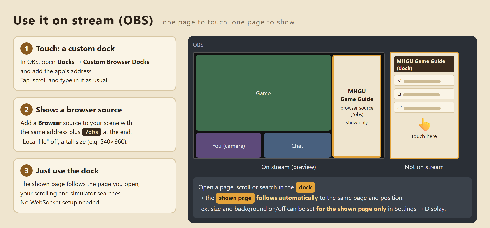

# MHGU Game Guide

*Unofficial fan-made tool. Not affiliated with Capcom.*

A pocket hunting notebook made for a group of four friends who hunt together. It runs in the browser on iPhone, Android and PC. Add it to your home screen and it keeps working where there is no signal.

> The app's screens are in Japanese for now.

## What it does

- **Progress check** – tick the quests you have cleared (a whole star rank at once if you like). Everything else follows your progress: the simulator and the search only use gear you can actually make.
- **Skill simulator** – pick the skills you want and it searches armor, decorations and charms. Fix or exclude pieces, series and decorations; set minimum defense, slots and resistances; skills you never want; search for extra skills that still fit; and when nothing is found, it shows the weakest charm that would make it work. Results can be listed, shown as a table and sorted. Save sets as mysets with their material totals and compare them side by side.
- **Charms** – register your charms and use them in the simulator, or try a friend's charms. Import and export in the same text format as other skill simulators.
- **Search in every direction** – materials, armor, decorations, monsters and quests all link to each other, including where an item drops, which quest rewards it and what it is used for. Kana input works.
- **Monsters** – elemental weakness chart, hitzones, status resistances, break parts, crown sizes, carves and capture rewards, and quest HP. Trap / flash / sonic bomb effectiveness with durations.
- **Maps** – area connections, gathering spots per area and rank (with the chance of each table), fishing spots, hot / cold areas and the secret area of each map.
- **Quests** – reward chances, kill vs capture, start / move / rest areas on the map, unlock conditions traced back through the key quests, client lists, and what to bring.
- **Arena** – fastest time per weapon (solo and pair) gathered from 3DS and Switch records, the S / A / B time limits and rank rewards.
- **Weapons** – upgrade trees, the path from what you own to the final level with the best quests for missing materials, bowgun ammo tables, and a damage ranking against a chosen monster.
- **Recommendations** – for a quest and weapon type: which of your weapons, armor sets and item sets to bring, a full pouch suggestion, and what to craft next.
- **Mechanics notes and calculators** – sleep bombing, evasion frames, fixed damage (bombs, ammo, gunlance shelling, ballista and cannons, blast), reload and recoil, buff stacking. Calculators for attack buffs, shelling, fixed damage and blast hits.
- **Share with friends** – turn your mysets, charms, crafted gear, progress and item counts into a text you can paste into a chat. Friends' data is stored separately from yours and can be compared side by side.
- **Display** – light and dark mode, text size, and a transparent background option.

## Use it on stream (OBS)

Use one page to touch (a custom dock) and another page to show (a browser source). The shown page follows the dock: the page you open, how far you scroll and simulator searches. No WebSocket setup is needed.



1. In OBS, open **Docks → Custom Browser Docks** and add the app's address. This is the page you touch.
2. Add a **Browser** source to your scene with the same address plus `?obs` at the end (leave "Local file" off; a tall size such as 540×960 works well).
3. That's it – just use the dock. The shown page never saves anything. Its text size and background can be set separately under Settings → Display.

## Your data

Your progress, charms and other entries are saved in this device's browser automatically. Export them to a file from Settings and import the file on another device to move. Clearing the browser's data also clears what you saved, so export now and then.

## Requirements

A recent mobile browser on iOS or Android (Safari, Chrome), or a PC browser.

## For developers

No build step: serve `index.html` from any web server.

```
py -m http.server 8765        # local check
node tests/sim.test.mjs       # simulator (incl. brute-force checks and virtual charms)
node tests/share.test.mjs     # share text
node tests/plan.test.mjs      # quest suggestions, charm picking
node tests/calc.test.mjs      # buff stacking calculator
node tests/dmgcalc.test.mjs   # shelling / fixed damage / blast calculators
node tests/hikyo.test.mjs     # secret area gathering per rank
node tests/version.test.mjs   # every ?v= matches; bump VERSION in js/app.js, all ?v= and sw.js together on each release
```

The JSON files in `data/` are made by the scripts in `tools/` (for example `node tools/make_arena.mjs` for `data/arena.json`). `data/monnotes.json`, `data/maplayouts.json` and `data/hikyo.json` are written by hand.
